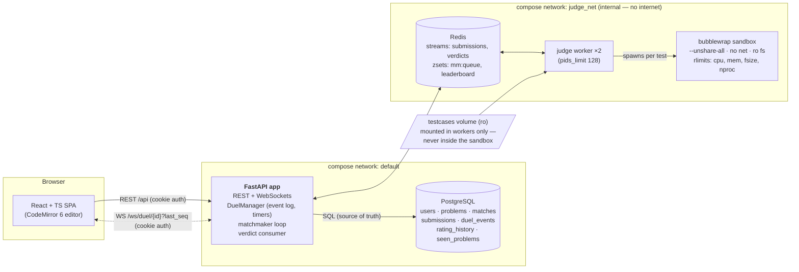
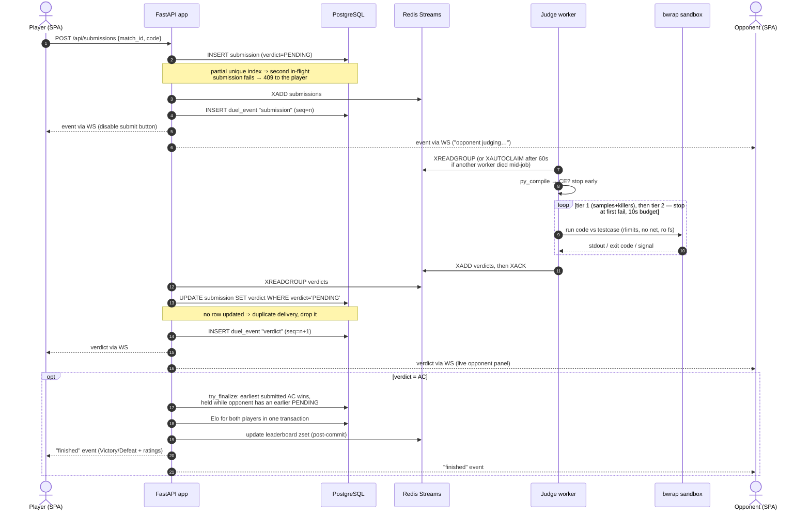
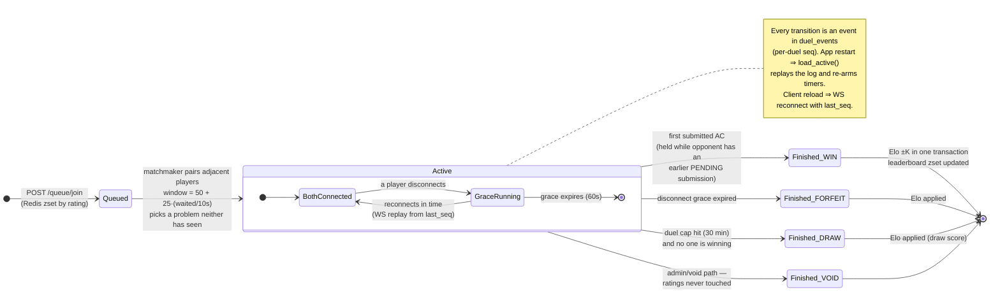

# CodeClash — architecture

Three views of the system, from broad to narrow: the containers and how they
talk, what happens to a single submission, and the duel state machine.

## 1. System overview — who talks to whom

The whole trick of the architecture is in the two compose networks: the app
talks to Postgres and Redis, the judge workers talk **only to Redis** on an
internal network with no internet. Contestant code runs one layer deeper, in a
bubblewrap sandbox that can't even see Redis. The testcases volume is mounted
only into the workers, never into the sandbox.

Key point: Redis sits on **both** networks and is the only bridge between the
app and the workers. A worker never touches Postgres; the app never touches a
sandbox. If a worker is compromised by contestant code (it shouldn't be — the
sandbox is the real wall), the blast radius is the Redis queue, not the
database.

## 2. Life of a submission — from click to Elo

Idempotency is carried by two database constraints, not by careful code:
a partial unique index allows only one PENDING submission per player per match
(the 409), and the verdict write is `UPDATE … WHERE verdict='PENDING'`, so a
redelivered or duplicated verdict is a no-op. Streams + consumer groups +
XAUTOCLAIM give at-least-once delivery; the idempotent write upgrades that to
effectively-once.

## 3. Duel lifecycle — states, timers, recovery

Every state-changing fact about a duel is appended to `duel_events` with a
per-duel sequence number **before** it is broadcast. That single decision buys
three features at once: clients reconnect with `last_seq` and replay what they
missed (page reload), the app rebuilds every active duel from the log on
restart (crash recovery), and clients dedupe by seq so redelivery is harmless.

## How the pieces map to code

| Piece | Where |
|---|---|
| REST + WS routes | `app/codeclash/{auth,match,matchmaking,rating,problems}/router.py` |
| Duel state machine, event log, timers | `app/codeclash/match/duel.py` (`DuelManager`) |
| Verdict consumer (stream → DB → duel) | `app/codeclash/match/verdicts.py` |
| Matchmaker loop | `app/codeclash/matchmaking/service.py` |
| Elo + leaderboard | `app/codeclash/rating/{elo,service,leaderboard}.py` |
| Worker loop (claim → judge → ack) | `judge/worker.py` |
| Tiered judging, verdict mapping | `judge/judging.py` |
| Sandbox construction | `judge/sandbox.py` |
| Schema + constraints | `db/migrations/*.sql` (applied by `app/codeclash/migrate.py`) |
| SPA | `frontend/src/` (React + TS + Vite, built into `app/static`) |
